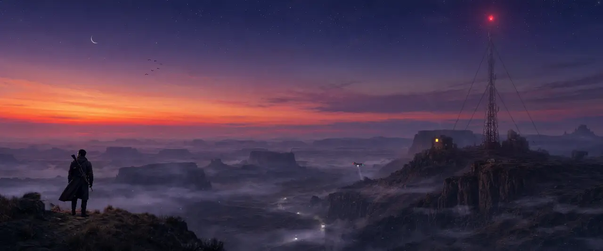
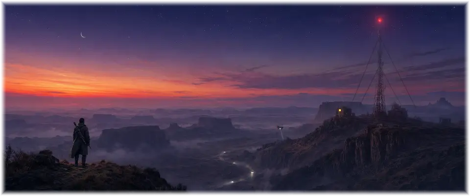

# Topside Mountain View

An animated theme for [Omarchy](https://omarchy.org). A scout on a ledge at dusk, looking out over
the mesas: his coat moving in the wind, a radio mast blinking on the far cliff, a drone on patrol, a
convoy crawling through the fog in the valley. Now and then he kneels to watch the road through
binoculars, then walks off the ledge and later walks back.

> **Animated with [omarchy-live-wallpaper](https://github.com/Gleasonmt/omarchy-live-wallpaper).**
> Install that plugin too (below) to make the wallpaper move and to get the
> **Topside Mountain View Lite** version. Without it the theme still works, with a still wallpaper.



## Install

Theme and plugin together:

```bash
omarchy theme install https://github.com/Gleasonmt/omarchy-topside-mountain-view-theme && omarchy plugin add https://github.com/Gleasonmt/omarchy-live-wallpaper --enable --yes
```

or one at a time:

```bash
omarchy theme install https://github.com/Gleasonmt/omarchy-topside-mountain-view-theme
omarchy plugin add https://github.com/Gleasonmt/omarchy-live-wallpaper --enable
```

Then pick **Topside Mountain View** in Omarchy menu → Style → Theme. The first line is the theme
(colors, wallpaper, icons, keyboard lighting); the second makes the wallpaper move,
and also adds **Topside Mountain View Lite** to the picker. Without the plugin you get the theme
with a still wallpaper.

Already have the plugin? Run `omarchy plugin update`: this scene needs its support for
picture layers and video. Update the theme itself with `omarchy theme update`.

## Topside Mountain View Lite

The same scene with the scout standing still and only small details alive (the mast's light,
the drone, the vehicles). It uses the least power, which makes it good for battery or a
calmer desktop:



## How it moves

The scene is four pictures stacked in depth (`live/*.png`: the sky, the far valley, the
cliff with the mast, the near ledge) and a GPU shader (`live/1-mountain-view.frag.qsb`,
source in `src/`) that drifts a camera slowly across them, so near things slide past far
ones, and draws the fog, clouds, lights, drone and vehicles. The scout is a looping
2-minute video (`live/scout.mp4`, colour and mask side by side) that the
[live-wallpaper plugin](https://github.com/Gleasonmt/omarchy-live-wallpaper) decodes on the GPU.
`backgrounds/1-mountain-view.png` is a frame of it, used by the lock screen and when the
plugin isn't installed. Everything pauses while a window covers the screen. See the plugin's
README for frame rates and battery settings.

The painting and the scout's movement were made with AI image and video models, then
cut into layers, cleaned up and animated by hand. The look is inspired by films and
games; no logos or characters are used.

## Performance

Measured on a Dell Latitude 9520 (Intel Iris Xe graphics, 8 threads) driving a 3440×1440
monitor, plugged in, with the plugin's default 30 fps. The wallpaper pauses whenever a window
covers the screen, so these are the costs while it's actually visible:

| Mode | GPU used | Wallpaper CPU | Compositor CPU |
|---|---|---|---|
| Still (plugin off) | ~0% | 2% | 4% |
| **Topside Mountain View Lite** | ~7% | 10% | 8% |
| Topside Mountain View, half resolution | ~11% | 9% | 8% |
| **Topside Mountain View** | ~50% | 8% | 6% |

*GPU used* is how busy the GPU was, weighted by its clock speed against its maximum
(1350 MHz here). *CPU* is a share of one core. Full motion is the heaviest: the scene is
drawn fresh at full resolution about 30 times a second, which works the GPU hard and
costs battery. Lite and half resolution are far lighter, and look nearly the same
from a normal distance.

On battery the plugin draws at half resolution and 10 fps by default (plugin 1.1.2 or
later: run `omarchy plugin update`). To use half resolution plugged in too, set
`"renderScale": 0.5` in `~/.config/omarchy/live-wallpaper.json` (see the
[plugin's README](https://github.com/Gleasonmt/omarchy-live-wallpaper)), or pick
**Topside Mountain View Lite** for the lightest moving version.

## Making changes

The scene is `src/1-mountain-view.frag` (with `src/common.glsl`); `src/scene.json` lists
the pictures and the video it uses. Edit it, then run

```bash
tools/build.sh           # rebuilds live/*.frag.qsb and live/*.json, the still in backgrounds/ and preview.jpg
tools/build.sh --media   # also the animated previews in media/ (a few minutes)
```

and commit the results. Needs `qt6-shadertools`, `qt6-declarative`, ImageMagick, jq and
(for `--media`) ffmpeg. To try a change on your own desktop, run
`omarchy theme update` after pushing, or copy the built files into
`~/.config/omarchy/themes/topside-mountain-view/`.

## License

[MIT](LICENSE)
